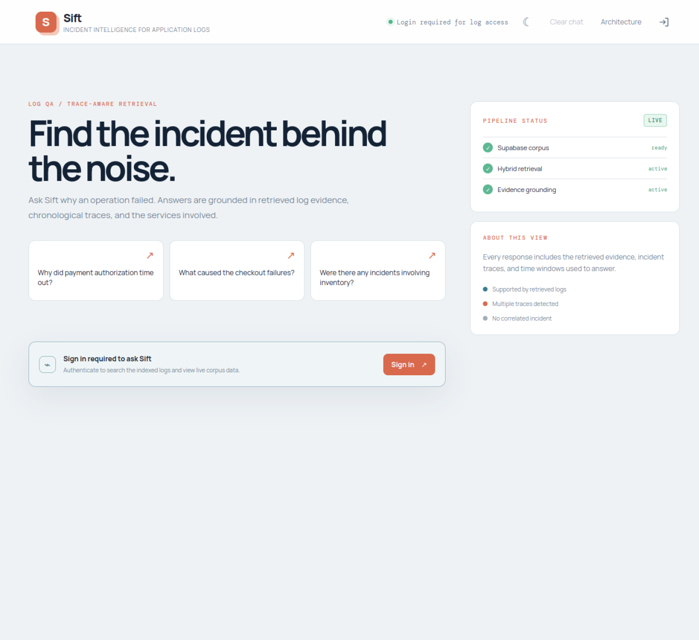
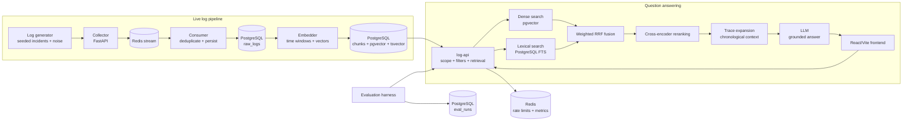
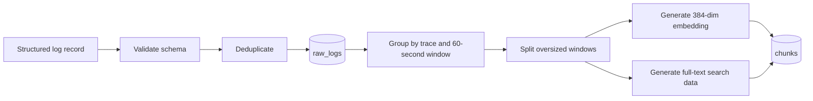
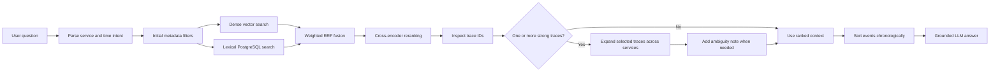

# Sift

Sift is an incident-investigation application for structured application logs. It
turns noisy service logs into searchable evidence, trace-aware incident context,
and answers grounded in retrieved records.

The repository contains a live ingestion pipeline, a hybrid retrieval API, a
React chat interface, an evaluation harness, and production deployment files.

**Live demo:** [sift-beta.vercel.app](https://sift-beta.vercel.app/)

<a href="https://sift-beta.vercel.app/">
  
</a>

## Product tour

The frontend includes three views:

- **Chat** — ask why an incident happened and inspect the answer, evidence,
  traces, and chronological timeline.
- **Architecture** — an interactive explanation of the ingestion and retrieval
  flow, technologies, deployment, and supported query types. Open the deployed
  frontend and choose **Architecture** to explore it.
- **Production metrics** — a private admin view for request traffic, errors,
  rate limiting, latency, payload rejections, and approximate unique
  authenticated visitors.

## Architecture



The deployed runtime is split across managed services:

| Component | Local development | Production |
|---|---|---|
| Frontend | Vite dev server | Vercel |
| API | Docker Compose | Google Cloud Run |
| Database and authentication | Supabase or local PostgreSQL | Supabase PostgreSQL + Supabase Auth |
| Rate limits and metrics | Local Redis | Upstash Redis |
| Log generation | Local command or GitHub Actions | GitHub Actions scheduled producer |
| Consumer and embedder | Docker Compose | Cloud Run Jobs triggered by GitHub Actions |

The API reads `chunks` directly from PostgreSQL. It does not receive records
from the embedder at runtime; both services use the shared database.

<details>
<summary>Explore the pipeline step by step</summary>

1. **Generate** — scripted incident scenarios and background noise produce
   structured records with timestamps, services, levels, and trace IDs.
2. **Collect** — the collector validates records and writes them to a bounded
   Redis stream.
3. **Persist** — the consumer reads the stream, deduplicates records, and
   stores them in `raw_logs`.
4. **Embed** — the embedder groups records into chronological windows and
   writes embeddings plus lexical-search data to `chunks`.
5. **Understand** — the API parses service and temporal intent from a question.
6. **Retrieve** — dense, lexical, reranked, filtered, and trace-expanded
   evidence is assembled into chronological context.
7. **Answer** — the LLM produces a grounded response; reliability gates can
   abstain, flag ambiguity, or request one evidence-focused retry.

</details>

## RAG approach

### Ingestion and chunking

Every log record follows a shared schema containing timestamp, level, service,
message, trace ID, and metadata. The consumer deduplicates records into
`raw_logs`. The embedder groups records into chronological, fixed-size windows
and stores:

- human-readable chunk content;
- service and trace metadata;
- window start and end timestamps;
- a 384-dimensional `BAAI/bge-small-en-v1.5` embedding;
- PostgreSQL full-text search data.



### Retrieval pipeline

1. Parse supported service and temporal expressions.
2. Apply metadata filters as an initial search boundary.
3. Run dense vector search and PostgreSQL lexical search.
4. Fuse both rankings with weighted reciprocal rank fusion.
5. Rerank candidates with `cross-encoder/ms-marco-MiniLM-L-6-v2`.
6. Use trace IDs from the candidate pool to expand complete incident traces.
7. For multiple strong traces, expand them separately and add an ambiguity note.
8. Sort the final context chronologically before sending it to the LLM.

Metadata filters are entry points, not causal boundaries. Trace expansion can
retrieve related services and events outside the initial service or time filter
so upstream causes are not lost. Context and trace expansion are capped to
protect latency and prompt size.



### Reliability controls

- **Deterministic scope gate:** rejects clearly out-of-scope questions such as
  weather, revenue, and customer demographics without retrieval.
- **Confidence gate:** abstains on weak unfiltered retrieval when no incident
  trace supports the result.
- **Evidence gate:** checks generated claims against retrieved chunks and can
  perform one bounded evidence-focused retry.
- **Deterministic empty retrieval:** avoids asking an LLM to invent an answer
  when no evidence is available.
- **Fallback disclosure:** temporal misses can use broader context, but the
  answer and retrieval metadata disclose that fallback.
- **Redis sliding-window rate limiting:** limits requests per authenticated user
  and fails closed if the shared limiter is unavailable.

These choices improve lexical matching for exact incident terms, preserve causal
cross-service context, make ambiguity visible, and reduce unsupported answers.
They also add latency and do not guarantee that every competing incident is
found.

## Retrieval progression

Sift was built incrementally. Each layer addresses a different failure mode:

<details>
<summary>Dense retrieval — semantic similarity</summary>

Embeddings find conceptually related incidents even when the question and log
use different wording. This is useful for vague root-cause questions, but can
also return semantically similar noise.

</details>

<details>
<summary>Hybrid retrieval — dense plus lexical search</summary>

PostgreSQL full-text search catches exact service names, error codes, order IDs,
and distinctive log phrases. Reciprocal rank fusion combines those results
with dense similarity instead of depending on either signal alone.

</details>

<details>
<summary>Reranking — cross-encoder relevance refinement</summary>

The cross-encoder scores the question and candidate chunk together. This
improves the ordering of the small final evidence set after broad retrieval.

</details>

<details>
<summary>Query filtering — metadata and trace-aware expansion</summary>

Service and temporal expressions narrow the initial search. Trace expansion
then restores related services and causal events so a service filter does not
hide the upstream cause. Multiple strong traces are kept separate and called
out as ambiguity.

</details>

<details>
<summary>Self-RAG — answerability and evidence controls</summary>

The confidence, scope, and evidence gates make abstention deterministic,
validate generated claims against retrieved chunks, and bound corrective
retries. The main benefit is safer behavior and better observability, not a
guaranteed increase in every aggregate RAGAS metric.

</details>

## Evaluation

The evaluation harness runs the same frozen 32-question set through `/ask` for
all five improvements and stores one row per question in `eval_runs`. The set
covers root cause, ambiguity, service and temporal queries, weak similarity,
out-of-scope questions, empty retrieval, and fallback behavior. This keeps the
stage comparison controlled: the question set, corpus, and scoring policy stay
constant while retrieval and reliability features are added.

The graph below shows the **improvement across retrieval stages** for the demo.
It presents the quality trend as dense retrieval is extended with lexical
search, reranking, query filtering, and Self-RAG controls. Refresh it with a
new evaluation when publishing a formal results report. All metrics use a 0–1
scale; behavior match is shown as a proportion.

```mermaid
xychart-beta
    %%{init: {"themeVariables": {"xyChart": {"plotColorPalette": ["#2563eb", "#16a34a", "#d97706", "#dc2626", "#7c3aed"]}}}}%%
    title "Metric improvement on the same 32 questions"
    x-axis [Dense, Hybrid, Reranking, Filtering, Self-RAG]
    y-axis "Metric score" 0 --> 1
    line [0.68, 0.73, 0.78, 0.82, 0.86]
    line [0.72, 0.76, 0.80, 0.83, 0.86]
    line [0.65, 0.72, 0.80, 0.85, 0.88]
    line [0.61, 0.69, 0.77, 0.84, 0.88]
    line [0.75, 0.81, 0.86, 0.91, 0.96]
```

<div>
<span style="color:#2563eb">━</span> Faithfulness &nbsp;&nbsp;
<span style="color:#16a34a">━</span> Answer relevancy &nbsp;&nbsp;
<span style="color:#d97706">━</span> Context precision &nbsp;&nbsp;
<span style="color:#dc2626">━</span> Context recall &nbsp;&nbsp;
<span style="color:#7c3aed">━</span> Behavior match (%)
</div>

The behavior-match line is normalized for the shared chart: `0.96` represents
`96%`. The pattern is that hybrid retrieval
improves exact-term coverage, reranking improves candidate ordering, filtering
improves retrieval focus, and Self-RAG improves answerability and evidence
handling.

Run an evaluation locally:

```bash
RAGAS_MAX_TOKENS=4096 \
log_generator/.venv/bin/python -m evaluation.run_eval \
  --api-url http://localhost:8001 \
  --questions evaluation/questions_stage4.json \
  --stage local_baseline_$(date +%Y%m%d) \
  --delay-seconds 60 \
  --metric-delay-seconds 60
```

Use a new stage name for each distinct run. Compare runs only when the question
set, corpus, model configuration, and scoring policy are unchanged.

## Technology stack

| Area | Technologies | Purpose |
|---|---|---|
| API | Python, FastAPI, Uvicorn, Pydantic | HTTP API, validation, lifecycle |
| Retrieval | PostgreSQL, pgvector, PostgreSQL full-text search, RRF | Dense/lexical hybrid retrieval |
| Models | Sentence Transformers, BGE-small, MiniLM cross-encoder | Embeddings and reranking |
| Generation | LangChain Core, LangChain OpenAI/Ollama integrations | Provider-compatible LLM calls |
| Auth | Supabase Auth, JWT/JWKS, Google OAuth, email/password | Protected API access |
| State | Redis, Upstash Redis | Streams, rate limits, metrics |
| Frontend | React, TypeScript, Vite, React Markdown | Chat, evidence, architecture, metrics |
| Testing | Pytest, HTTPX, Docker Compose validation | Unit, API, and configuration checks |
| Deployment | Docker, GitHub Actions, Google Cloud Run, Cloud Run Jobs, Vercel | CI/CD and managed hosting |

## Local setup

Requirements: Python 3.13, Docker Compose, Node.js 22, and credentials for the
selected LLM provider.

```bash
git clone https://github.com/kunalkoshti/Sift.git
cd Sift

cp .env.example .env
python3 -m venv log_generator/.venv
log_generator/.venv/bin/pip install -e \
  '.[dev,log_generator,log_collector,log_consumer,log_embedder,log_api,evaluation]'
```

For a simple local setup, use Ollama or a configured remote provider and keep
authentication disabled initially:

```dotenv
AUTH_REQUIRED=false
CORS_ORIGINS=http://localhost:5173
```

Start the database, Redis, collector, consumer, and API:

```bash
docker compose up -d --build redis postgres log-collector log-consumer log-api
```

Generate a small incident corpus and embed it:

```bash
log_generator/.venv/bin/python log_generator/send_to_collector.py \
  --collector-url http://localhost:8000 \
  --scenario payment-timeout-v1 \
  --seed 101 \
  --noise-count 20 \
  --batch-size 5 \
  --output /tmp/sift-live.jsonl

docker compose run --rm --build log-embedder
```

Check the API:

```bash
curl -fsS http://localhost:8001/health | jq
curl -sS -X POST http://localhost:8001/ask \
  -H 'Content-Type: application/json' \
  -d '{"question":"Why did payment authorization time out?"}' | jq
```

Run the frontend:

```bash
cd frontend
cp .env.example .env.local
# Set VITE_API_URL=http://localhost:8001 and Supabase variables as needed.
npm ci
npm run dev
```

Open `http://localhost:5173`. When local authentication is enabled, configure
Supabase redirect URLs for the local frontend and set `VITE_ADMIN_EMAILS` for
the private metrics link.

## Production deployment

Production deployment is performed by GitHub Actions after tests pass on a push
to `main`:

- frontend changes deploy the React app to Vercel;
- API or deployment changes build and deploy `log-api` to Cloud Run;
- live producer changes run through the scheduled GitHub Actions producer;
- consumer and embedder jobs process Redis and update Supabase periodically.

Configure repository variables for the project, region, artifact repository,
stable Vercel URL, Supabase URL, and API service name. Configure secrets for
Google Workload Identity, Vercel, the shared Upstash Redis URL, and database/LLM
credentials as required by the workflow. Keep credentials out of Git and local
`.env` files.

The Cloud Run API uses a small database pool and one instance by default to fit
Supabase connection limits. Cloud Run health checks use `/health`; protected
API calls require a valid Supabase access token. The admin metrics page is
authorized independently by the backend `ADMIN_EMAILS` or `ADMIN_USER_IDS`
allowlist.

## Scope and limitations

Sift is a focused incident-investigation demo, not a complete observability
platform. It currently does not provide high availability, alerting, tenant
isolation, full log retention management, guaranteed causal proof, or perfect
multi-incident attribution. Trace expansion and context size are capped, and
LLM/provider quotas can affect latency and evaluation completeness.

The evaluation set is frozen for controlled comparisons but is not a held-out
test set. Further tuning against it can overfit the reported results.

## Validation commands

```bash
docker compose config --quiet

AUTH_REQUIRED=false \
log_generator/.venv/bin/python -m pytest \
  evaluation log_collector log_consumer log_embedder log_generator log_api -q

cd frontend && npm run build
```
